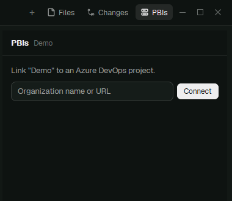

# Azure DevOps PBIs for Herdr

A Herdr layout with a side panel that shows the Azure DevOps PBIs of the project linked to each space. Each PBI is a card. A card opens the work item, or starts a Claude Code agent on it.

## Install

Ask your agent in Herdr:

> Add the layout from https://github.com/JellyPuddingPie/Herdr-Azure-Devops-Integration

Or copy the files by hand:

1. Copy `layouts/main-pbis.json` to `~/.config/herdr-app/layouts/`.
2. Copy `mods/pbis`, `mods/pbi-planner` and `mods/tabs-pbis` to `~/.config/herdr-app/mods/`.
3. Run `herdr-app check` on each of the three mod folders.
4. Switch to the layout: `herdr-app do layout.switch --name main-pbis`, or press `Ctrl+Shift+L`.

## Use

1. Select a space and click **PBIs** in the tab bar.
2. Type the Azure DevOps organization name (or its URL) and click **Connect**.
3. The first time for an organization's tenant, click **Sign in with Microsoft**. Enter the code on the Microsoft page and pick the account that has access.
4. Pick the project. The space is now linked to it.

**Assigned to me** shows only your items. **Unlink** removes the link of the space.

## Plan new PBIs

Click **Plan** in the tab bar. It opens the PBI planner for the project linked to the space.

1. Click **+ New plan**. Give it a name and paste your text, such as meeting notes or a scope.
2. Click **Draft with Claude**. Claude Code reads the text and the open Features of the project. It drafts Features with PBIs under them. This takes about half a minute.
3. The plan shows as a tree: the plan, its Features and their PBIs, joined by arrows. The arrow color shows the state: gray new, green created, red failed, dashed blue for a Feature that already exists in DevOps. Switch to **Columns** for a board view.
4. Click a card to read and edit it: title, description, acceptance criteria, effort, tags and Feature. Use **+ PBI** and **+ Feature** to add items.
5. Click **Create N items in DevOps** and confirm. The planner creates the Features, then the PBIs under them. Each card then shows its new ID.

Nothing goes to Azure DevOps before step 5. Plans are saved, so you can come back to them. If an item fails, fix it and click Create again: items that already exist are skipped.

The planner needs Claude Code (`claude`) on the PATH, signed in.

## What it reaches

- `login.microsoftonline.com`, to sign in (device code flow, Microsoft's public client for Visual Studio).
- `dev.azure.com`, to read projects and work items. Only the planner writes, and only when you click Create.
- It runs `curl` once per organization to find the organization's tenant.
- The planner runs `claude -p` with your pasted text, so the text goes to Claude.
- It keeps your space links and your sign-ins in `~/.config/herdr-app/data/`. The sign-in file holds refresh tokens: keep it private.

## Limits

- Shows work item types Product Backlog Item and User Story that are not Done, Removed or Closed. At most 200.
- `tabs-pbis` is a copy of Herdr's tab bar. It does not get Herdr's later changes to the tab bar.
