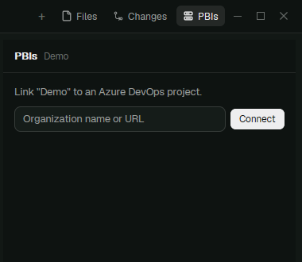

# PBIs

A side panel that shows the open Azure DevOps Product Backlog Items (PBIs) of the project linked to the shown space. Each space links to one project. The panel opens from a **PBIs** button in the tab bar, next to Files and Changes. Each PBI is a card with its ID, state, effort, assignee, title and a short description. A card can start a Claude Code agent on that PBI in a new tab.

## What you see

The layout is Herdr's `main` layout with one extra panel. Left to right:

- The sidebar with spaces and agents, as in `main`.
- The work column: the tab bar (`tabs-pbis`, 42 px), the active tab, and the status bar (28 px).
- The right panel (`panel`, 368 px, hidden by default). It is a stack with three children: `files`, `changes` and `pbis`.

The PBIs panel, top to bottom:

- A header, 42 px: "PBIs" in semibold, the linked project name in dim text, and the item count with the time of the last load on the right.
- A toolbar: **Refresh**, **Assigned to me** (accent border and text while on) and **Unlink** on the right.
- A line "Signed in as <account>" with **Sign out**, when a sign-in exists for the tenant.
- The cards, in a scrolling list with 8 px gaps. Each card has a 1 px `border`, `surface` background and 9 px radius. Line 1: `#<id>` in `accent`, a status pill, effort and assignee in `dim`, then a small **Start agent** button. The status pill is 18 px high and fully rounded, with a 6 px dot and the state name. Its color comes from the state: Done or Closed `ansi2` (green), On hold or Blocked `ansi1` (red), Testing, Review or Resolved `ansi5` (magenta), Committed, Active, In progress or Dev `ansi3` (yellow), Approved or Ready `ansi4` (blue), anything else `muted`. The border is the color at alpha `66`, the fill at alpha `1f`. Line 2: the title in 13 px semibold. Line 3: up to 180 characters of the description in `muted`.

When the space has no link, the panel shows a field "Organization name or URL" with a **Connect** button. After Connect it lists the projects of the organization, with a filter field. Click a project to link it.

## How it behaves

- **Per space:** the link is stored by space ID. Switching spaces shows the PBIs of that space's project. The tab bar remembers per space whether the panel was open, like Files and Changes.
- **Which items:** work item types `Product Backlog Item` and `User Story`, not in state Done, Removed or Closed, in backlog order. At most 200.
- **Assigned to me:** filters on `[System.AssignedTo] = @Me`. The choice is kept in `localStorage`.
- **Description:** the Description field as plain text. When it is empty, the Acceptance Criteria field.
- **Refresh:** every 5 minutes, and with the Refresh button.
- **Click a card:** opens the work item in the browser.
- **Start agent:** runs `tab.new` with `argv: ["claude"]`, the tab named `#<id>`, and a task with the ID, title, description and URL.
- **Sign-in:** Microsoft device code flow, one sign-in per tenant. The panel shows a code, puts it on the clipboard and opens the Microsoft page. It polls until the person signs in. Then it reloads.
- **Agent status:** the panel does not show agent status. The tab bar shows it as in `main`.

## Built from

- Layout `layouts/main-pbis.json`: a clone of `main` (`layout.clone`). Two changes: the `tabs` block uses mod `tabs-pbis`, and the `panel-body` stack has a third child `{ "id": "pbis", "type": "block", "content": { "mod": "pbis" } }`.
- Mod `tabs-pbis`: a clone of the shipped `tabs` mod (`mod.clone`). Two changes: `enabled` always includes `"pbis"`, and a third `panelButton("pbis", "PBIs", "mods/pbis/pbis.svg")` after Changes.
- Mod `pbis` (`main.js`, `mod.json` with `"place": "none"`, `pbis.svg`).
  - `herdr` functions: `spaces`, `exec`, `run`, `theme`, `appHome`, `shared` (only to take over links from an older version).
  - Commands: `tab.new`.
  - Network: `fetch` to `login.microsoftonline.com` (device code and token endpoints) and to `dev.azure.com` (projects, WIQL, work items, API version 7.1).
  - Programs: `curl`, once per organization, to read the `X-VSS-ResourceTenant` header of an anonymous request. That header names the tenant.
  - Client ID `872cd9fa-d31f-45e0-9eab-6e460a02d1f1` (Microsoft's public client for Visual Studio). Scope `499b84ac-1321-427f-aa17-267ca6975798/.default offline_access openid profile`.
  - Files: `data/pbis-links.json` (space ID to `{ org, project }`) and `data/pbis-auth.json` (tenant to `{ refresh_token, user }`), under the app home.

## Watch out

- `shared()` read back `null` for a value the mod had set, after a hot reload. So the links live in a file of the mod, not in shared state.
- An organization belongs to one Entra tenant. A token from another tenant gives "not authorized". Always ask for the token at the organization's tenant, never at `organizations` when the tenant is known.
- The anonymous `_apis/connectionData` request returns no tenant header. `_apis/projects` does (a 302 with `X-VSS-ResourceTenant`).
- Azure DevOps answers a bad token with 203 and an HTML sign-in page, not only with 401. Treat a response that is not JSON as a sign-in problem.
- There is no `line_clamp` in gpui-kit. The description is cut to 180 characters in code.
- `fetch` responses have no headers, which is why the tenant lookup uses `curl`.
- `tabs-pbis` is a clone. It does not get updates of Herdr's own tab bar.
- `data/pbis-auth.json` holds refresh tokens. Never share or commit it.

## Done when

- `herdr-app check mods/pbis` and `herdr-app check mods/tabs-pbis` pass, and `herdr-app status` shows `"errors": []` on `main-pbis`.
- The tab bar shows **PBIs** after Changes. Clicking it opens the panel, and clicking again closes it.
- An unlinked space shows the organization field. Connect with an organization the person can reach lists its projects.
- Without a sign-in, the panel offers **Sign in with Microsoft**. After the sign-in, the cards load without a restart.
- Switching to another linked space shows that project's PBIs.
- **Assigned to me** shows only the person's items, and the button stays highlighted while it is on.
- **Start agent** opens a new tab named `#<id>` with Claude Code working on that PBI.
